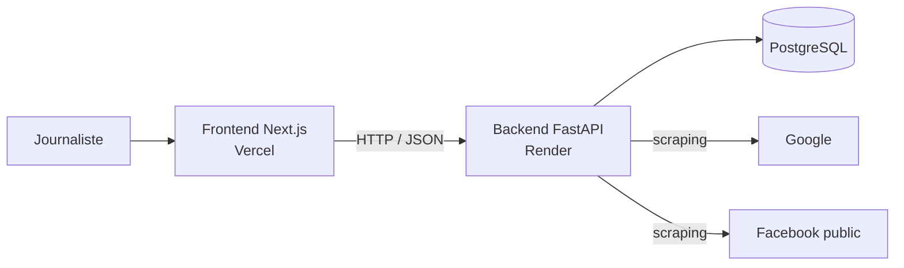

<div align="center">

# FANILO

### Voir clair dans l'information

**Plateforme de veille et de vérification de l'information pour les journalistes et professionnels des médias à Madagascar.**


[ Application](https://hackaton-ifm.vercel.app/) · [ Documentation API (Swagger)](https://hackaton-fanilo.onrender.com/docs) · [ Dépôt GitHub](https://github.com/Anthonio08/42Hackathon-Fanilo-vp_dev)

</div>

---

## Sommaire

- [Description](#description)
- [Démo en ligne](#démo-en-ligne)
- [Instructions](#instructions)
- [Fonctionnalités](#fonctionnalités)
- [Architecture](#architecture)
- [Stack technique](#stack-technique)
- [Limites de l'application](#limites-de-lapplication)
- [API : endpoints](#api--endpoints)
- [Exemples d'utilisation](#exemples-dutilisation)
- [Problèmes fréquents](#problèmes-fréquents)
- [Resources](#resources)
- [Équipe](#équipe)

---

## Description

**FANILO** est né lors du **Hackathon FANILO 2026**, organisé à **42 Antananarivo** par l'Institut français de Madagascar et le service de presse de l'Ambassade de France.

À l'heure où la désinformation circule vite, en malgache comme en français, sur Facebook et sur le web, un journaliste a peu de temps pour trier ce qu'il reçoit. FANILO l'aide à **collecter l'actualité, vérifier une affirmation ou une rumeur, et dialoguer avec un assistant** pour repérer ce qui mérite d'être vérifié.

Le projet est composé de deux parties qui travaillent ensemble :

| Partie | Rôle |
|---|---|
| **Frontend** (Next.js) | Interface web : actualités, détail d'un article, assistant de vérification |
| **Backend** (FastAPI) | API : authentification, collecte de news, vérification automatisée des faits |

---

## Démo en ligne

| Service | Adresse |
|---|---|
| Application (frontend) | https://hackaton-ifm.vercel.app/ |
| API : documentation Swagger | https://hackaton-fanilo.onrender.com/docs |
| API : URL de base | https://hackaton-fanilo.onrender.com/api/v1 |

> Si la première requête est lente, c'est normal : le serveur d'hébergement peut avoir besoin de quelques instants pour se réveiller.

---

## Instructions

### Prérequis

- **Git**
- **Python 3.10+** et **make**
- **Docker** et **Docker Compose** (pour PostgreSQL)
- **Node.js** (version LTS) et **npm**

```bash
git --version
python3 --version
make --version
docker --version
node -v
npm -v
```

### 1. Récupérer le projet

```bash
git clone https://github.com/Anthonio08/42Hackathon-Fanilo-vp_dev.git
cd 42Hackathon-Fanilo-vp_dev
```

> Les deux parties sont dans des dossiers séparés. Dans les commandes ci-dessous, `backend/` désigne le dossier du code FastAPI et `frontend/` celui du code Next.js : adaptez ces noms à la structure réelle du dépôt si besoin.

### 2. Lancer le backend (FastAPI)

Ouvrez un premier terminal et entrez dans le dossier du backend :

```bash
cd backend
```

Créez le fichier de configuration `.env` (connexion à la base de données, clé secrète JWT...) en suivant l'exemple fourni dans le dossier s'il existe.

Puis lancez les commandes dans cet ordre :

```bash
make up-docker   # démarre le conteneur PostgreSQL
make install     # crée l'environnement virtuel et installe les dépendances
make migrate     # applique les migrations de la base de données
make reload      # lance le serveur avec rechargement automatique
```

(Pour un lancement sans rechargement automatique, utilisez `make run` à la place de `make reload`.)

| Service | Adresse locale |
|---|---|
| API | http://localhost:8000 |
| Documentation Swagger | http://localhost:8000/docs |

> Laissez ce terminal ouvert : le backend doit rester lancé pendant l'utilisation de l'application.

### 3. Lancer le frontend (Next.js)

Ouvrez un **second terminal** et entrez dans le dossier du frontend :

```bash
cd frontend
```

Créez un fichier `.env.local` à la racine du dossier :

```env
NEXT_PUBLIC_API_URL=http://localhost:8000
```

> Pour utiliser directement l'API en ligne, mettez à la place : `NEXT_PUBLIC_API_URL=https://hackaton-fanilo.onrender.com`

Puis installez les dépendances et démarrez :

```bash
npm install
npm run dev
```

L'application est disponible sur **http://localhost:3000**.

> Next.js ne lit `.env.local` qu'au démarrage : relancez `npm run dev` après toute modification.

### 4. Utiliser l'application

1. Ouvrez http://localhost:3000.
2. Parcourez les actualités et ouvrez un article pour lire son contenu et ses commentaires.
3. Cliquez sur le bouton 💬 en bas à droite pour ouvrir l'assistant de vérification.
4. Collez un texte ou une rumeur dans le chat et envoyez-le.

### Résumé des commandes

| Étape | Dossier | Commandes |
|---|---|---|
| Backend | `backend/` | `make up-docker` → `make install` → `make migrate` → `make reload` |
| Frontend | `frontend/` | `npm install` → `npm run dev` |

---

## Fonctionnalités

### Frontend

- **Actualités** : liste d'articles filtrable par catégorie, avec pagination.
- **Détail d'un article** : contenu, commentaires et articles similaires.
- **Assistant de vérification** : chatbot flottant, visible sur toutes les pages. L'utilisateur colle un texte ou une rumeur et l'assistant indique les signaux d'alerte à vérifier.
- **Gestion de la conversation** : l'historique est conservé à la fermeture du chat, et un bouton permet de l'effacer.

### Backend

- **Authentification JWT** : inscription, connexion, profil, rôles (`admin`, `journalist`, `user`).
- **Collecte d'actualités** : récupération automatique de publications depuis Google (web) et Facebook (pages publiques), et ajout manuel par les journalistes.
- **Gestion des articles** : liste paginée, filtre par statut (`pending`, `verified`, `fake`, `unverified`), recherche plein texte, mise à jour du statut, suppression.
- **Vérification automatisée des faits** : soumission d'une affirmation, recherche multi-sources en temps réel, analyse de pertinence et détection de posture (confirmation ou démenti), puis attribution d'un **verdict** et d'un **score de confiance** :

| Verdict | Signification |
|---|---|
| `likely_true` | Affirmation probablement vraie |
| `likely_false` | Affirmation probablement fausse / infox |
| `mixed` | Sources contradictoires, avis partagés |
| `insufficient_data` | Données insuffisantes pour trancher |

Chaque vérification fournit aussi un score de confiance (de 0.0 à 1.0), un résumé d'analyse en français et la liste des sources analysées. L'historique est consultable par utilisateur et en version publique.

---

## Architecture



---

## Stack technique

| Couche | Technologies |
|---|---|
| Frontend | Next.js, React, TypeScript, Tailwind CSS |
| Backend | FastAPI (Python 3.10+), Uvicorn |
| Base de données | PostgreSQL, SQLAlchemy (AsyncIO), Alembic (migrations) |
| Collecte de données | httpx, BeautifulSoup4 |
| Sécurité | JWT (PyJWT, HS256), Passlib (bcrypt) |
| Déploiement | Vercel (frontend), Render (backend) |

---

## Limites de l'application

FANILO est un **prototype réalisé en 48 heures**. Il facilite le travail de vérification mais ne remplace ni le jugement d'un journaliste ni un travail de fact-checking rigoureux.

- **Verdict indicatif** : les verdicts (`likely_true`, `likely_false`...) et le score de confiance sont des **estimations automatiques** fondées sur l'analyse de sources trouvées en ligne. Ils ne constituent pas une preuve et doivent toujours être recoupés avec des sources fiables.
- **Dépendance aux sources externes** : la collecte repose sur du scraping de Google et de pages publiques Facebook. Elle peut être ralentie, bloquée ou devenir incomplète si ces services changent leur structure ou limitent les requêtes.
- **Réponses de l'IA non garanties** : l'assistant peut se tromper, passer à côté d'une rumeur ou donner une réponse imprécise.
- **Couverture limitée du malgache** : l'analyse est moins fiable en malgache qu'en français, et les expressions locales ou récentes peuvent ne pas être reconnues.
- **Texte uniquement** : la vérification d'images, de vidéos et de contenus audio (y compris générés par IA) n'est pas prise en charge.
- **Dépendance au réseau** : sans le backend et une connexion fonctionnelle, l'assistant et la vérification ne répondent pas.
- **Sécurité à renforcer** : avant un déploiement à grande échelle, prévoir une limitation d'usage, une protection avancée de l'API et une revue des aspects légaux liés à la collecte de données.

---

## API : endpoints

URL de base : `/api/v1` (documentation interactive sur `/docs`).

### Authentification : `/api/v1/auth`

| Méthode | Route | Description |
|---|---|---|
| POST | `/auth/register` | Inscription d'un nouvel utilisateur |
| POST | `/auth/login` | Connexion JSON (retourne le token JWT) |
| POST | `/auth/token` | Connexion OAuth2 form (compatible Swagger) |
| GET | `/auth/me` | Informations de l'utilisateur connecté |

### News : `/api/v1/news`

| Méthode | Route | Description |
|---|---|---|
| POST | `/news/collect` | Collecte des news depuis Google et Facebook |
| POST | `/news/` | Création manuelle d'un article |
| GET | `/news/` | Liste paginée des actualités collectées |
| GET | `/news/search?q=...` | Recherche par mot-clé |
| GET | `/news/{id}` | Détail d'une actualité |
| PATCH | `/news/{id}/status` | Mise à jour du statut (`verified`, `fake`...) |
| DELETE | `/news/{id}` | Suppression d'un article |

### Vérification : `/api/v1/verification`

| Méthode | Route | Description |
|---|---|---|
| POST | `/verification/verify` | Vérifier une affirmation (Google + Facebook) |
| GET | `/verification/` | Historique de mes vérifications |
| GET | `/verification/all` | Historique public des vérifications |
| GET | `/verification/{id}` | Détail d'une vérification avec ses sources |
| DELETE | `/verification/{id}` | Supprimer une vérification |

---

## Exemples d'utilisation

Les exemples ci-dessous utilisent l'API locale. Remplacez `http://localhost:8000` par `https://hackaton-fanilo.onrender.com` pour l'API en ligne.

### 1. Se connecter

```bash
TOKEN=$(curl -s -X POST http://localhost:8000/api/v1/auth/login \
  -H "Content-Type: application/json" \
  -d '{"email": "journalist@example.com", "password": "Password123!"}' | jq -r .access_token)
```

### 2. Collecter des actualités (Google et Facebook)

```bash
curl -X POST http://localhost:8000/api/v1/news/collect \
  -H "Authorization: Bearer $TOKEN" \
  -H "Content-Type: application/json" \
  -d '{"query": "Madagascar", "num_results": 5, "source": "all"}'
```

### 3. Vérifier une information

```bash
curl -X POST http://localhost:8000/api/v1/verification/verify \
  -H "Authorization: Bearer $TOKEN" \
  -H "Content-Type: application/json" \
  -d '{"claim": "Madagascar est une île située dans l océan Indien"}'
```

---

## Problèmes fréquents

**Le chat répond « Impossible de joindre le service »**
Le backend n'est pas lancé, ou l'adresse dans `NEXT_PUBLIC_API_URL` est incorrecte.

**Erreur CORS dans la console du navigateur (F12)**
Le backend doit autoriser l'adresse du frontend (`http://localhost:3000` en local) dans sa configuration CORS.

**`make: command not found`**
Installez `make` (par exemple `sudo apt install make` sur Ubuntu).

**`make up-docker` échoue**
Vérifiez que Docker est lancé et que votre utilisateur a le droit de l'utiliser.

**`make migrate` échoue**
Vérifiez que PostgreSQL est démarré (`make up-docker`), que `make install` s'est terminé sans erreur et que le fichier `.env` du backend est correct.

**Le port 3000 ou 8000 est déjà utilisé**
Fermez l'ancien processus ou lancez le serveur sur un autre port.

**Les modifications du `.env.local` ne sont pas prises en compte**
Arrêtez `npm run dev` (Ctrl+C) puis relancez-le.

**La première requête vers l'API en ligne est très lente**
Le serveur d'hébergement se réveille : patientez quelques instants puis réessayez.

---

## Resources

### Documentation

- [Next.js](https://nextjs.org/docs) : framework du frontend
- [React](https://react.dev/) : bibliothèque d'interface
- [Tailwind CSS](https://tailwindcss.com/docs) : mise en forme
- [TypeScript](https://www.typescriptlang.org/docs/) : typage du code
- [FastAPI](https://fastapi.tiangolo.com/) : framework du backend
- [SQLAlchemy](https://docs.sqlalchemy.org/) et [Alembic](https://alembic.sqlalchemy.org/) : base de données et migrations
- [httpx](https://www.python-httpx.org/) et [BeautifulSoup4](https://www.crummy.com/software/BeautifulSoup/bs4/doc/) : collecte de données
- [Node.js](https://nodejs.org/) et [nvm](https://github.com/nvm-sh/nvm) : installation de Node sans droits administrateur

### Contexte du projet

- Hackathon FANILO 2026, porté par l'Institut français de Madagascar et le service de presse de l'Ambassade de France, en partenariat avec 42 Antananarivo.

### Utilisation de l'IA

Une IA (Claude) a été utilisée comme aide pendant le développement : Git et l'intégration avec l'API, et rédaction de la documentation. Le code a été relu, testé et adapté par l'équipe.

---

## Équipe

| Nom | Rôle |
|---|---|
| RANDRIANADO Yannick Kevin | Frontend |
| RAKOTOARISOA Finoana Charles | Création du chatbot |
| RAKOTONIAINA Safidinirina Anthonio | Frontend |
| RAKOTOMAMPIONONA Fitahiaina Herizo | Création du backend |

---

<div align="center">

Fait à Antananarivo · Hackathon FANILO 2026

</div>